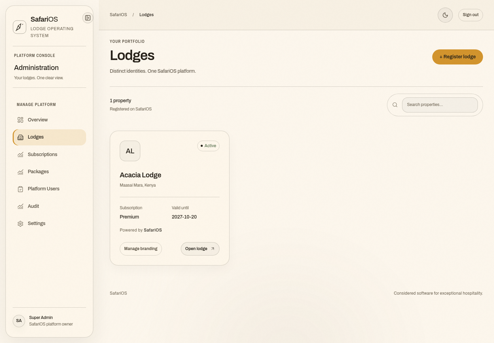

# SafariOS brand and translucent design system

The supplied screenshot guides the visual direction: a cream canvas, dark brown text, confident sans-serif headlines, and restrained frosted navigation. The owner-supplied palette is the source of truth for every screen and future component. Lodge identity remains visible alongside SafariOS; role and tenant permissions are unchanged.

## Foundations

`apps/web/app/design-system.css` defines the shared CSS tokens; `tailwind.config.ts` exposes the same palette, fonts, radius, duration, and type scale. Legacy operational classes inherit these semantic tokens. Do not create a second palette in a page or in `globals.css`.

| CSS token | Exact value | Tailwind color |
| --- | --- | --- |
| `--color-beige` | `#FCF6EC` | `beige` |
| `--color-gray` | `#F3EDE2` | `gray` |
| `--color-brown` | `#27221A` | `brown` |
| `--color-orange` | `#D2942D` | `orange` |
| `--color-brown-20` | `rgba(39,34,26,0.2)` | `brown-20` |
| `--color-beige-20` | `rgba(252,246,236,0.2)` | `beige-20` |

Dark mode uses brown background, beige text, glass `rgba(252,246,236,.08)`, and beige-20 borders. Light uses beige background, brown text, glass `rgba(252,246,236,.6)`, and brown-20 borders. Both use blur 24px and saturation 160%. Light is the default, matching the supplied cream reference. A valid saved dark/light preference is restored before paint.

Primary buttons are solid orange with brown text in both themes. Active selections, focus glow, chart accents, and numerical highlights use orange. Small text on beige must remain brown. Reading accents therefore use `--text-accent` (orange in dark mode, brown in light); large figures retain an orange underline in light mode to preserve contrast. Muted success, warning, danger, and info colors use sage, ochre, clay, and gray-green, with darker text variants in light mode. Evaluate contrast against the composited surface, not just the background token.

The default light canvas stays flat cream, matching the supplied screenshot. Frosted navigation uses a muted translucent gray-beige surface. The optional dark theme retains a low-opacity warm mesh; reduced-motion preferences disable its drift. Browsers without backdrop filtering receive solid theme surfaces. Avoid unrelated colored glows or purple gradients.

## Typography and shape

Headings and hero titles: Archivo 600, with tight tracking and a bold sans-serif silhouette matching the supplied screenshot. Body and controls: Archivo, weights 400/500/600. Compact uppercase section labels use Archivo Narrow 600. Display numbers use Archivo 600. There are no serif display faces. Fonts are bundled locally and do not require a third-party runtime request.

Section labels and tags use uppercase text and tracking 0.08em. The shared scale is 12/14/16/20/28/40/56px. CSS font tokens are `--font-body`, `--font-heading`, `--font-display`; Tailwind families are `font-sans`, `font-heading`, `font-display`, and `font-label`.

Radius tokens are sm 12px, md 16px, lg 24px for cards, xl 28px for dialogs, and pill 9999px for buttons/chips. CSS uses `--radius-*`; Tailwind exposes the same names plus semantic aliases `card`, `modal`, and `input`. Transitions use fast 0.2s ease, base 0.3s ease, slow 0.5s ease. Framer Motion supplies springs for larger page/dialog movements and honors reduced motion.

## Components and future screens

Import reusable primitives from `@/components/ui`: Button (Radix Slot and class variants), Card, Input, Badge, Skeleton, DataTable (TanStack sorting), Calendar (react-day-picker), and ConfirmDialog. `components.json` records the shadcn-compatible aliases and theme configuration. These are application-owned primitives rather than a separate UI framework.

Use the existing `Drawer` wrapper for record editors. It uses Radix Dialog on desktop and Vaul on mobile, with focus containment, accessible titles, Escape dismissal, and scroll locking. `WorkspaceCommand` provides cmdk search using only authorized modules. `Providers` supplies Framer Motion spring defaults (300/30), reduced-motion handling, and Sonner notifications. Page templates fade and slide 8px. New charts should reuse `DataViz` (Recharts) and preserve a readable nonvisual summary.

Desktop navigation floats away from the edge and can collapse; the preference persists. Mobile quick tabs show only permitted destinations. More opens a focus-managed drawer listing the authorized screens. Existing top-bar navigation remains available. Avoid adding primary actions to every card: choose one clear action per page and keep secondary work contextual.

For forms, use React Hook Form with Zod, connected labels, inline errors with `aria-describedby` and `aria-invalid`, and server error messages. The lodge branding editor demonstrates this approach. Do not replace API validation with client checks. Confirm destructive changes before submitting; the logo removal flow demonstrates ConfirmDialog. Provide loading, empty, error/retry, and success states; never populate production views with fictitious records.

Every new screen must use the shared shell and semantic tokens. Keep visible focus rings, native keyboard controls, meaningful accessible names, 44px action targets, and reduced-motion behavior. New bespoke components still require review; a shared stylesheet cannot guarantee accessibility for arbitrary future markup.

## Review

Browser tests cover existing account isolation plus theme persistence, collapse state, mobile drawers, keyboard command search, inline branding validation, reduced motion, and horizontal overflow. Screenshot fixtures use mocked frontend records for review only; they do not create production data.

- [Default cream lodge portfolio](screenshots/safarios-lodges-light.png)
- [Optional dark lodge portfolio](screenshots/safarios-lodges.png)
- [Mobile portfolio](screenshots/safarios-lodges-mobile.png)
- [Branding dialog](screenshots/safarios-branding.png)
- [Lodge dashboard](screenshots/safarios-workspace.png)
- [Mobile lodge dashboard](screenshots/safarios-workspace-mobile.png)
- [Sign in](screenshots/safarios-login.png)
- [Mobile sign in](screenshots/safarios-login-mobile.png)

Run `npm ci --prefix apps/web`, `npm run build --prefix apps/web`, and `BROWSER_EXECUTABLE_PATH=/usr/bin/chromium npm test --prefix e2e` (after `npm ci --prefix e2e`). See `LOCAL_SETUP.md` for Docker setup; preserve `infra/.env` and database volumes when updating.

`apps/web/AGENTS.md` carries these conventions into future UI work. The current validation includes 265 surface contract checks and browser checks of account isolation and the new interactions. Automated WCAG A/AA checks cover the dark/light portfolio and login fixtures; this is representative coverage, not a complete manual accessibility certification of every workflow.
