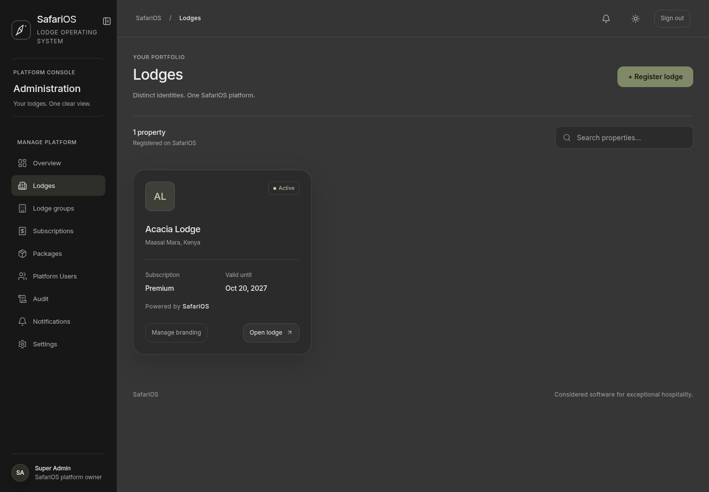

# SafariOS charcoal and olive design system

The latest owner-supplied reference replaces the earlier beige/orange design. Match its quiet charcoal canvas, muted olive actions, restrained Inter typography, compact corners and deliberate spacing. SafariOS and each lodge’s authorized branding remain visible together.

## Shared implementation

`apps/web/app/reference-theme.css` is the current semantic token and component specification, loaded after legacy styles in the root layout. `tailwind.config.ts` exposes the same tokens. Use shared components and semantic variables for future screens; do not introduce page-specific palettes. Older beige/orange variable names are compatibility aliases, not an alternative brand palette.

| Token | Dark default | Light alternative |
| --- | --- | --- |
| Background | `#363636` | `#F3F4EF` |
| Navigation | `#171717` | `rgba(234,237,228,.86)` |
| Glass surface | `rgba(39,39,39,.68)` | `rgba(255,255,253,.70)` |
| Primary text | `#EEEEEB` | `#252820` |
| Secondary text | `#B2B3AA` | `#575D50` |
| Accent | `#7F8967` | `#7F8967` |
| Accent hover | `#929D78` | `#929D78` |
| Reading accent | `#C2CBB0` | `#4B593B` |

Primary buttons use olive with dark text for accessible small-text contrast. Status colors use muted sage, clay, ochre and gray-green semantic tokens. Keep bright gradients and orange/purple accents out of this system. Existing explicit light/dark preferences persist; fresh browsers start dark.

## Typography and spacing

Inter is bundled locally at 400, 500 and 600. UI text is 13–14px; secondary labels 11–12px; screen titles 30px/500, mobile 26px; card titles 16px/500; key numbers 36px/500. Use -0.025em heading tracking and tabular figures. Avoid heavy, oversized headlines in operational screens. Keep 44px mobile touch targets.

Geometry/material tokens live in `app/design-system.css` and are exposed through Tailwind. The palette in `reference-theme.css` maps them into existing components.

The desktop sidebar is flush to the left, 238px wide, with a thin separator and no outer corner rounding. The collapsed rail remains available. The top bar is 76px high. Content padding uses the shared 32px section token. Cards have 24px padding and 24px gutters. Mobile uses 20px page/card padding, 16px gutters, focus-managed drawers and the existing bottom navigation.

Corner tokens: small 8px, inputs/buttons 12px, cards/tables 24px, dialogs/drawers 28px. Avatars remain circular; buttons are no longer pills. Avoid nested double borders and inconsistent corner sizes.

## Glass and motion

Panels, navigation, dialogs and drawers use `backdrop-filter: blur(32px) saturate(115%)`, with prefixed Safari support, translucent charcoal fills and subtle borders. Backdrop blur acts on content behind a surface; keep text and controls sharp. Overlay backdrops blur at 12px. Solid semantic surfaces are the fallback when filtering is unsupported. The dark canvas is exactly `#363636` and the sidebar exactly `#171717`. Background meshes and dark-mode grain are disabled; use no olive tint behind the interface. Olive belongs only to interactive accents. Subtle inset material highlights and layered shadows provide depth; avoid decorative glows or floating-card movement.

Respect reduced motion and retain shared Framer Motion configuration for page/dialog transitions. Preserve keyboard focus, labels, empty/loading/error states, account-change protection, MFA, permissions and tenant isolation. A visual refresh does not change access policy.

Validate material changes with a production build, browser interactions, accessibility checks and desktop/mobile screenshots in both themes. Screenshots use test fixtures; they do not populate customer data or establish complete accessibility certification.
