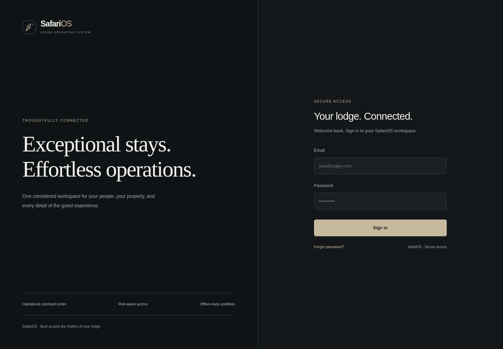
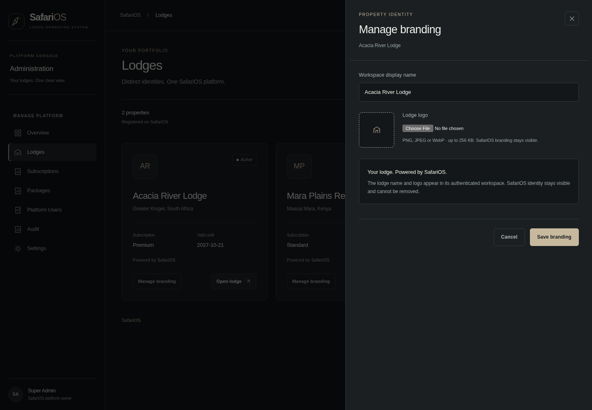
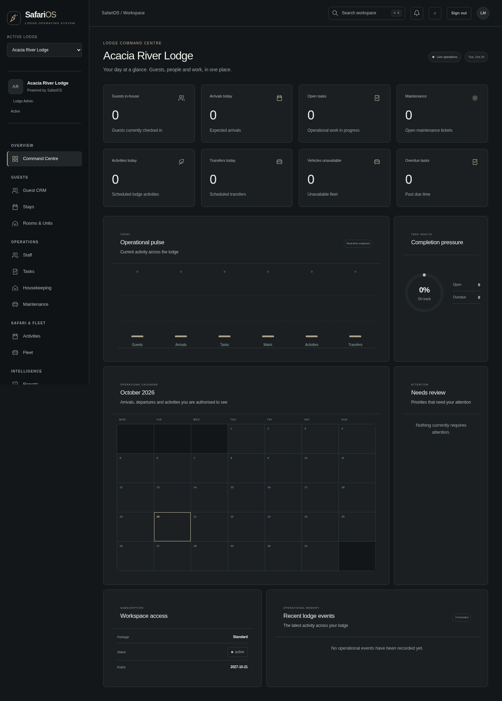

# SafariOS — Quiet precision

The owner requested a complete change to the shared design language: premium and modern, with dark charcoal and restrained colors. The application now identifies itself as SafariOS and supports lodge-specific identities configured by Super Admin.

## Visual system

| Token | Dark default | Purpose |
| --- | --- | --- |
| Canvas | `#141719` | Main workspace |
| Navigation | `#101315` | Persistent SafariOS identity |
| Surface | `#1b1f22` | Panels and property cards |
| Secondary surface | `#22272a` | Quiet interaction hierarchy |
| Border | `#32393d` | Subtle separation |
| Primary text | `#f0f0eb` | Main information |
| Secondary text | `#b0b7b7` | Supporting information |
| Muted text | `#9aa5a5` | Labels and metadata |
| Accent | `#c7b99e` | Warm stone, primary actions and identity |

The default is charcoal; an optional daylight theme remains available. No gradients or glowing primary actions are introduced. The new layer removes legacy decorative entrance effects. Line icons replace symbolic navigation glyphs. System sans-serif typography is used for operational interfaces, with editorial serif typography on the sign-in introduction. No external font or image downloads are needed.

`apps/web/app/design-system.css` owns the new theme and component treatments over the existing structural stylesheet. Shared navigation, controls, fields, tables, metrics, cards, notifications and operational drawers receive the new visual system. Product descriptions were rewritten around staff workflows rather than implementation details.

## Interaction changes

- A property portfolio replaces the dense lodge administration table. Search, subscription status, expiry and branding actions are easy to find.
- Registration separates property identity, subscription and administrator details. Logo setup is available during registration or later through Manage branding.
- Branding changes have preview, validation, busy/error/success states and explicit removal. If lodge creation succeeds but its subsequent logo save fails, the UI directs the operator to Manage branding rather than encouraging duplicate registration.
- All shared drawers now use native modal dialogs for focus containment, Escape handling and an inert background; focus is restored on close.
- Platform navigation works on narrow screens with an off-canvas menu. The lodge workspace retains account and role guards.
- Mobile property and login screens were checked at 390px without horizontal overflow. Focus indicators and reduced-motion support remain available.

## Branding model

Every package can use a custom lodge display name and logo; this owner requirement supersedes older package descriptions that deferred all branding. SafariOS remains visible in the platform, login, lodge navigation and the Powered by SafariOS attribution. A lodge's display name does not rename its registered legal/property record.

The shared sign-in screen is SafariOS branded. Lodge-specific branding appears after authenticated lodge selection. Anonymous lodge login domains, guest portals, branded report exports and deeper white-label/domain customization are outside this change.

Super Admin alone can update branding. Lodge accounts can read their own branding. Logos are accepted as PNG, JPEG or WebP, limited to 256 KB and four megapixels, normalized to PNG up to 512 pixels, and stripped of source metadata. SVG and animated input are rejected. One bounded logo is stored with the lodge in PostgreSQL and included in database backups; it does not depend on MinIO being available. Logo payloads are deferred from ordinary lodge queries until needed.

Migration `0009_lodge_branding` adds nullable logo storage and a display name defaulting to the original lodge name. Existing records are preserved. Rebuilding via Compose runs migrations before the API starts.

## Visual review

These are actual browser captures of the new interface. Authenticated portfolio images use isolated illustrative fixtures, not customer data or records seeded into the application.

[Mobile sign-in capture](screenshots/safarios-login-mobile.png).

## Verification

Backend coverage includes branded names, private asset access, Super Admin mutation rights, audit records, image validation, EXIF removal, name-only changes and logo removal. Browser coverage exercises mobile portfolio layout, upload preview/save, modal Escape behavior, the joint lodge/SafariOS identity and existing account isolation. The upgrade was also applied from the previous local database revision. These checks do not establish a production deployment or a full accessibility certification.

[Mobile operational workspace](screenshots/safarios-workspace-mobile.png).

Final local validation: 372 backend/source tests passed, seven browser checks passed, production build passed, and Python dependency audit reported no known vulnerabilities after updating the affected certificate bundle. The database upgraded from revision 0008 to 0009. Static guard audit covered 127 routes. Hosted CI and a production deployment are separate and are not claimed here.
