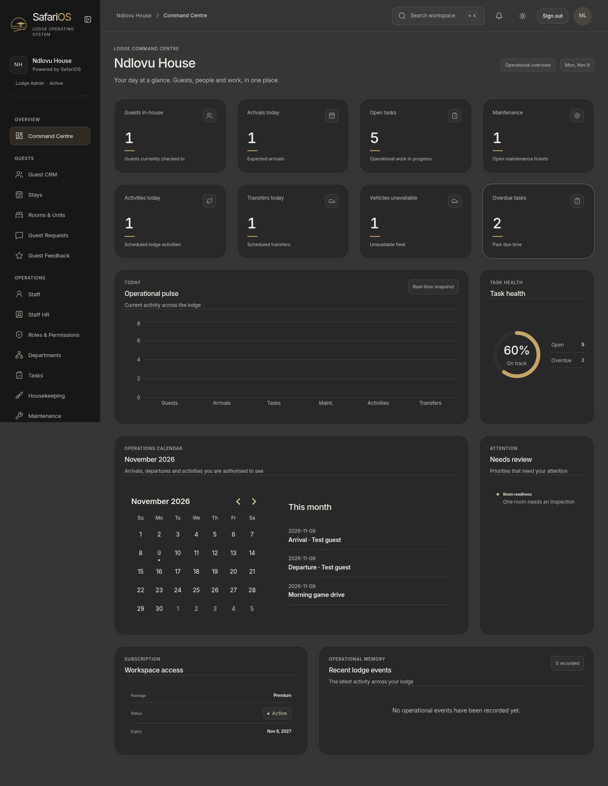

# SafariOS premium minimalist design system

The latest owner-supplied reference replaces the earlier beige/orange design. Match its quiet charcoal canvas, matte gold actions, restrained Inter typography, compact corners and deliberate spacing. SafariOS and each lodge’s authorized branding remain visible together.

## Shared implementation

`apps/web/app/reference-theme.css` is the current semantic token and component specification, loaded after legacy styles in the root layout. `tailwind.config.ts` exposes the same tokens. Use shared components and semantic variables for future screens; do not introduce page-specific palettes. Older beige/orange variable names are compatibility aliases, not an alternative brand palette.

| Token | Dark default | Light alternative |
| --- | --- | --- |
| Background | `#363636` | `#F5F3EF` |
| Navigation | `#171717` | `#EEEBE5` |
| Glass surface | `rgba(39,39,39,.86)` | `rgba(255,253,249,.90)` |
| Primary text | `#F2EEE7` | `#29251E` |
| Secondary text | `#C0BCB4` | `#59544B` |
| Accent | `#C6A568` | `#C6A568` |
| Accent hover | `#D3B67F` | `#D3B67F` |
| Reading accent | `#DFC899` | `#70532D` |

Primary buttons use matte gold with dark text for accessible small-text contrast. Status colors use muted sage, clay, ochre and gray-green semantic tokens. Keep bright gradients and orange/purple accents out of this system. Existing explicit light/dark preferences persist; fresh browsers start dark.

## Typography and spacing

Inter is bundled locally at 400, 500 and 600. UI text is 13–14px; secondary labels 11–12px; screen titles 30px/500, mobile 26px; card titles 16px/500; key numbers 36px/500. Use -0.025em heading tracking and tabular figures. Avoid heavy, oversized headlines in operational screens. Keep 44px mobile touch targets.

Geometry/material tokens live in `app/design-system.css` and are exposed through Tailwind. The palette in `reference-theme.css` maps them into existing components.

The desktop sidebar is flush to the left, 238px wide, with a thin separator and no outer corner rounding. The collapsed rail remains available. The top bar is 76px high. Content padding uses the shared 32px section token. Cards have 24px padding and 24px gutters. Mobile uses 20px page/card padding, 16px gutters, focus-managed drawers and the existing bottom navigation.

Corner tokens: small 8px, inputs/buttons 12px, cards/tables 24px, dialogs/drawers 28px. Avatars remain circular; buttons are no longer pills. Avoid nested double borders and inconsistent corner sizes.

## Glass and motion

Panels, navigation, dialogs and drawers use `backdrop-filter: blur(32px) saturate(115%)`, with prefixed Safari support, translucent charcoal fills and subtle borders. Backdrop blur acts on content behind a surface; keep text and controls sharp. Overlay backdrops blur at 12px. Solid semantic surfaces are the fallback when filtering is unsupported. The dark canvas is exactly `#363636` and the sidebar exactly `#171717`. Background meshes and dark-mode grain are disabled; use no colour tint behind the interface. Gold belongs to interactive accents and brand details. Subtle inset material highlights and layered shadows provide depth; avoid decorative glows or floating-card movement.

Respect reduced motion and retain shared Framer Motion configuration for page/dialog transitions. Preserve keyboard focus, labels, empty/loading/error states, account-change protection, MFA, permissions and tenant isolation. A visual refresh does not change access policy.

Validate material changes with a production build, browser interactions, accessibility checks and desktop/mobile screenshots in both themes. Screenshots use test fixtures; they do not populate customer data or establish complete accessibility certification.

## Conversational AI

`LodgeAIPage` composes the shared `components/ai/ChatComposer`, `ChatMessage` and `MessageSources` components. Reuse these for future AI views and keep UI copy in `lib/strings/ai.ts`. The chat uses semantic charcoal/light materials, a narrow reading column, right-aligned question bubbles and left-aligned assistant answers. The composer stays below its independently scrolling transcript; it reserves space above mobile navigation. Desktop private history collapses; smaller screens use the shared focus-managed drawer. Knowledge management remains a separate, permission-checked view.

Show the submitted question immediately and a real pending state until the API returns. Do not simulate token streaming or add unsupported stop, attachment or voice controls. Enter submits, Shift+Enter inserts a line and IME composition never submits. Preserve the next draft during a request. Recoverable failures restore the submitted question if there is no newer draft; access changes clear the conversation. All asynchronous results must still match the current user, lodge and scope.

Render assistant Markdown with raw HTML disabled and model-authored links/images as text, so answers cannot execute HTML or fetch remote tracking images. Authoritative provenance stays in the server source disclosure. Tables scroll within their own container. Copy controls copy the actual answer and announce success or failure. Saved titles come from the owner's first question, redacted and bounded by the API, under the existing owner/tenant RLS and current access fingerprint.

## Brand assets and ongoing use

The owner’s SafariOS reference supplies the acacia/savannah symbol and ivory/gold wordmark direction. `SafariBrand` and `public/branding/safarios-mark.svg` are scalable SVG adaptations of that reference, rather than original licensed vector/type outlines. The same mark supplies the favicon. Light mode uses a darker gold wordmark (`#846437`) for readable contrast. Lodge logos remain separate and retain their existing authorization. Docker copies public assets into its standalone runtime.

The requested UI/UX Pro Max skill is installed at `.agents/skills/ui-ux-pro-max`, pinned with its MIT license and provenance. The accepted synthesis is in `design-system/safarios/MASTER.md`; generated marketing layouts and unrelated palettes are not application requirements.

Wrap operational tables in `components/ui/table-scroll.tsx`. Overflowing tables expose a named keyboard-focusable scrolling region; non-overflowing tables do not add a redundant tab stop. Reuse shared controls, materials and copy dictionaries for future screens. Dashboard metrics with unavailable values stay unavailable, and task health uses open tasks as its denominator.
